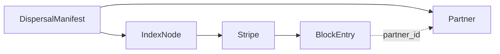

# DispersalManifest

Une instance existe par couple **(Utilisateur, Nœud)** : c'est le catalogue
complet des stripes, blocs et partenaires pour cet utilisateur. Chiffrée
intégralement avec [`crypto.k-attach`](../../03-crypto/k-attach.md), ancrée en
DHT sous `dht_key = H(K_attach)` (voir
[`network.dht-directory`](../../01-network-dht/dht-directory.md)).

## Champs de premier niveau

```
--8<-- "dispersal/DispersalManifest.table.md"
```

Le champ `root` référence un [`dispersal.IndexNode`](IndexNode.md) — c'est
la porte d'entrée de l'arbre d'index adaptatif décrit dans
[`protocols.index-adaptatif`](../../04-protocols/index-adaptatif.md) (§3.6).
Le champ `partners` référence la table [`dispersal.Partner`](Partner.md).

## Graphe de références de cette table

Ce diagramme n'est **pas maintenu à la main** : il reflète les `$ref` réels
présents dans `build/schemas/dispersal/DispersalManifest.schema.json`,
eux-mêmes dérivés du seul fichier `schemas/dispersal/DispersalManifest.fbs`.



## Ce que cette structure n'est pas

- **Pas** un compte-rendu passif transmis au Connecteur : le Nœud l'utilise
  lui-même pour la réparation ([`protocols.volatilite-reparation`](../../04-protocols/volatilite-reparation.md)),
  la comptabilité de troc ([`node.PartnerAccount`](../node/PartnerAccount.md))
  et les challenges PoS ([`securite.pos-challenges`](../../05-securite/pos-challenges.md)).
- **Pas** consultée par le Connecteur en fonctionnement normal — seulement en
  scénario de secours ([`protocols.acces-applicatif`](../../04-protocols/acces-applicatif.md#chemin-de-secours)).
- **Pas** la même chose qu'un `UserManifest` : celui-ci ne pointe que vers
  `fs_root_hash` ([`protocols.fs-structure`](../../04-protocols/fs-structure.md)),
  sans notion de stripe ni de parité.

## Cycle de vie DHT

Durée de vie 6 mois, republication mensuelle requise par le Nœud — détail
complet (dont les deux autres régimes d'expiration, User et Emergency) dans
[`network.dht-directory`](../../01-network-dht/dht-directory.md#expiration-et-republication),
**non répété ici**.

<!-- GENERATED:BACKLINKS:START (ne pas éditer, voir gen_docs.py) -->

## Référencé par

*(généré automatiquement au build)*

<!-- GENERATED:BACKLINKS:END -->
