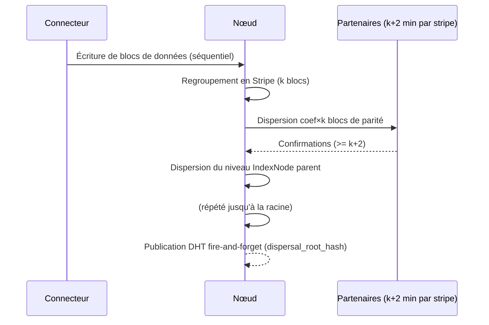

# Protocole Transactionnel de Dispersion

Grâce à l'adressage par contenu (chaque bloc/stripe/nœud d'index est
identifié par le hash de son contenu), une nouvelle version d'un
[`dispersal.DispersalManifest`](../02-schemas/dispersal/DispersalManifest.md)
ne modifie jamais l'ancienne — elle construit un nouvel arbre à côté
(copy-on-write). Tant que la DHT pointe encore sur l'ancienne racine,
l'ancienne version reste intégralement valide et récupérable.

## Étapes

1. **Dispersion ascendante (bottom-up)** : les
   [`dispersal.Stripe`](../02-schemas/dispersal/Stripe.md) feuilles modifiées
   sont dispersées en premier, puis les niveaux d'index qui les référencent,
   jusqu'à la racine — jamais l'inverse.
2. **Seuil de confirmation** : chaque Stripe doit recevoir au moins **k+2**
   confirmations partenaires avant que le niveau parent ne soit dispersé à
   son tour.
   `verified_by: []` — *aucun test de conformité automatisé n'existe encore
   pour ce seuil ; convention de liaison prête à être peuplée (voir
   frontmatter), pas d'implémentation de référence pour l'instant.*
3. **Commit = publication DHT** : une fois la racine confirmée, publication
   **fire-and-forget** de la nouvelle entrée DHT (`dispersal_root_hash` +
   `dispersal_root_partners`) — voir
   [`network.dht-directory`](../01-network-dht/dht-directory.md#champs-publies)
   pour le détail des champs publiés.
4. **Purge différée** : après un délai de grâce, tombstones bilatéraux
   ([`protocols.tombstones`](tombstones.md)) sur les blocs orphelins de
   l'ancienne version.
5. **Reprise après crash** : chaque étape est journalisée
   ([`node.MutationLog`](../02-schemas/node/MutationLog.md)) ; adressage par
   hash ⇒ reprise idempotente.

## Cas d'usage de ce protocole

Ce protocole "standard" est le mécanisme sous-jacent de plusieurs scénarios
qui ne sont **pas** redécrits ici, seulement référencés :

| Scénario | Page | Ce qui change par rapport au protocole standard |
|---|---|---|
| Changement de nœud hébergeur | [`protocols.migration-noeud`](migration-noeud.md) | Nouveau `K_attach`, ancien manifeste devient orphelin |
| Stripe partielle (padding par timeout) | [`protocols.erasure-coding`](erasure-coding.md#assemblage-progressif) | Nouveau `stripe_id` au remplacement du padding |
| Fraude PoS avérée d'un partenaire | [`securite.blacklist-fraude`](../05-securite/blacklist-fraude.md#reparation-proactive) | Déclenché immédiatement, hors cycle d'analyse quotidien |

## Diagramme

<!-- GENERATED:BACKLINKS:START (ne pas éditer, voir gen_docs.py) -->

## Référencé par

*(généré automatiquement au build)*

<!-- GENERATED:BACKLINKS:END -->
