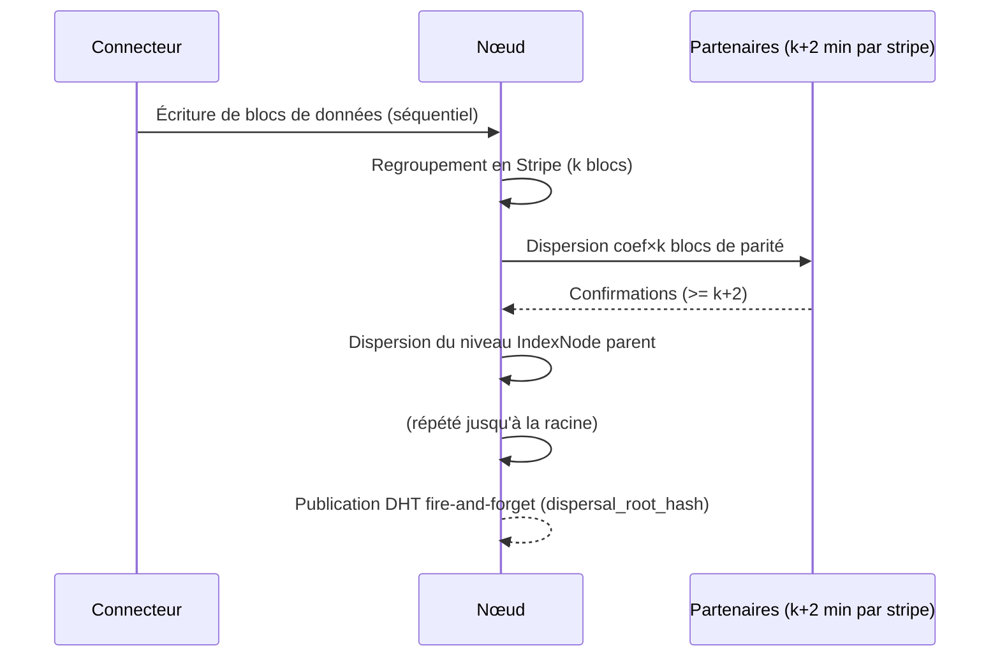

# Protocole Transactionnel de Dispersion

Grâce à l'adressage par contenu (chaque bloc/stripe/nœud d'index est
identifié par le hash de son contenu), une nouvelle version d'un
[`dispersal.DispersalManifest`](../02-schemas/dispersal/DispersalManifest.md)
ne modifie jamais l'ancienne — elle construit un nouvel arbre à côté
(copy-on-write). Tant que la DHT pointe encore sur l'ancienne racine,
l'ancienne version reste intégralement valide et récupérable.

## Étapes

1. **Dispersion ascendante (bottom-up)** : les
   [`dispersal.Stripe`](../02-schemas/dispersal/Stripe.md) feuilles modifiées
   sont dispersées en premier, puis les niveaux d'index qui les référencent,
   jusqu'à la racine — jamais l'inverse.
2. **Seuil de confirmation** : chaque Stripe doit recevoir au moins **k+2**
   confirmations partenaires avant que le niveau parent ne soit dispersé à
   son tour.
   Testé par `dispersion::parent_waits_for_k_plus_2_confirmations_on_every_child`
   (`impl/node`) : un partenaire ne compte qu'une fois par stripe.
3. **Commit = publication DHT** : une fois la racine confirmée, publication
   **fire-and-forget** de la nouvelle entrée DHT (`dispersal_root_hash` +
   `dispersal_root_partners`) — voir
   [`network.dht-directory`](../01-network-dht/dht-directory.md#champs-publies)
   pour le détail des champs publiés.
4. **Purge différée** : après un délai de grâce, tombstones bilatéraux
   ([`protocols.tombstones`](tombstones.md)) sur les blocs orphelins de
   l'ancienne version.
5. **Reprise après crash** : chaque étape est journalisée
   ([`node.MutationLog`](../02-schemas/node/MutationLog.md)) ; adressage par
   hash ⇒ reprise idempotente.

## Orchestration par le Nœud {: #orchestration }

Précisions d'implémentation (2026-11-20, `impl/SPEC_GAPS.md`) :

- **Blocs à disperser** : chaque bloc reçu d'un Utilisateur (`PutBlock`,
  [`protocols.echange-blocs`](echange-blocs.md)) entre dans l'assemblage
  progressif de [`protocols.erasure-coding`](erasure-coding.md#assemblage-progressif)
  (k = 4, coef = 3, constantes ; padding après `duree_max_idle_seconds`). Un
  stripe partiel est recréé dès l'arrivée de vrais blocs ; l'ancien est
  purgé par tombstones.
- **Placement** : les coef×k fragments de parité vont à coef×k partenaires
  distincts, choisis par distance XOR entre `node_id` et `stripe_id`
  (`stripe_id` = SHA-256 des hashes de ses k blocs de données) parmi ceux
  qui acceptent l'échange selon la règle 1:1
  ([`node.PartnerAccount`](../02-schemas/node/PartnerAccount.md#equilibre)) ;
  un partenaire injoignable ou qui refuse (`QuotaExceeded`) est remplacé par
  le suivant. Seul un reçu signé compte comme confirmation.
- **Arbre d'index** : un `IndexNode` tient dans un bloc chiffré
  ([`crypto.k-dispersal`](../03-crypto/k-dispersal.md)) ; il forme le bloc 0
  d'un stripe complet dont les k−1 autres blocs de données sont du padding,
  si bien que k fragments quelconques parmi N suffisent à le relire. L'arbre
  est réémis entièrement à chaque changement du catalogue (copy-on-write :
  les stripes de données inchangés sont repris tels quels) ; les anciens
  stripes d'index sont purgés après un délai de grâce de 3 600 s.
- **Publication** : `DispersalRootPointer` (avec `dispersal_root_stripe`)
  chiffré sous `K_attach`, signé par `sig_priv_dispersal`, publié sous
  `SHA-256(K_attach)` puis republié selon
  [`network.dht-directory`](../01-network-dht/dht-directory.md#expiration-et-republication).

## Cas d'usage de ce protocole

Ce protocole "standard" est le mécanisme sous-jacent de plusieurs scénarios
qui ne sont **pas** redécrits ici, seulement référencés :

| Scénario | Page | Ce qui change par rapport au protocole standard |
|---|---|---|
| Changement de nœud hébergeur | [`protocols.migration-noeud`](migration-noeud.md) | Nouveau `K_attach`, ancien manifeste devient orphelin |
| Stripe partielle (padding par timeout) | [`protocols.erasure-coding`](erasure-coding.md#assemblage-progressif) | Nouveau `stripe_id` au remplacement du padding |
| Fraude PoS avérée d'un partenaire | [`securite.blacklist-fraude`](../05-securite/blacklist-fraude.md#reparation-proactive) | Déclenché immédiatement, hors cycle d'analyse quotidien |

## Diagramme

<!-- GENERATED:BACKLINKS:START (ne pas éditer, voir gen_docs.py) -->

## Référencé par

*(généré automatiquement au build)*

<!-- GENERATED:BACKLINKS:END -->
